<p align="center">
  <picture>
    <source media="(prefers-color-scheme: dark)" srcset="assets/branding/logo.svg">
    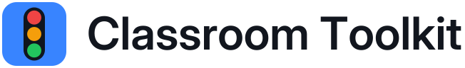
  </picture>
</p>

<p align="center">
  <b>Free, open-source tools for the classroom.</b><br>
  32 timers, pickers, quiz games and on-screen helpers for Windows, one click away.
</p>

<p align="center">
  <a href="https://lukeharrison1990.github.io/classroom-tools/"><b>Website</b></a> &nbsp;&nbsp;
  <a href="https://github.com/LukeHarrison1990/classroom-tools/releases/latest"><b>Download</b></a> &nbsp;&nbsp;
  <a href="docs/deploying.md"><b>Deploying in a school</b></a>
</p>

<p align="center">
  <a href="https://github.com/LukeHarrison1990/classroom-tools/releases/latest"></a>
  <a href="https://github.com/LukeHarrison1990/classroom-tools/actions/workflows/build.yml"></a>
  <a href="LICENSE"></a>
  
</p>

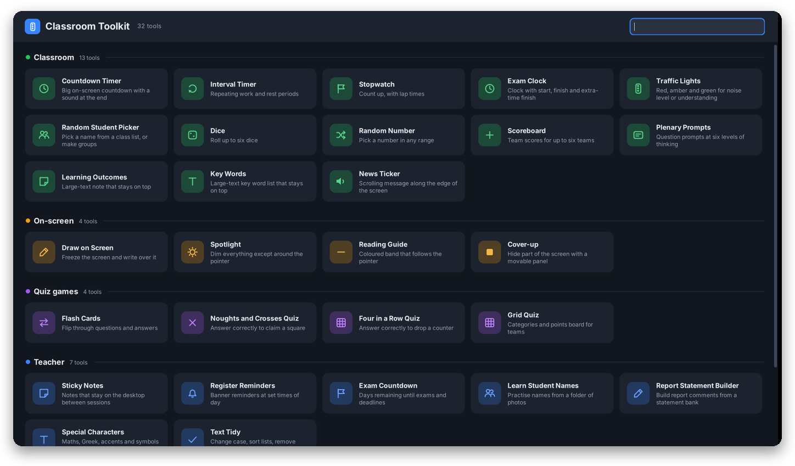

Classroom Toolkit puts the little tools a lesson needs in the corner of the
screen: a countdown on the board, a fair way to pick who answers, traffic
lights for noise, a quiz for the last ten minutes. It starts quietly by the
clock, opens any tool in a click, and every tool is designed to be read from
the back of the room and used on an interactive whiteboard.

- **One small program.** A single `.exe` with nothing to install and no
  administrator rights needed. It uses the .NET Framework already built into
  Windows.
- **Your own lists.** Class lists, quiz questions, report statements and
  quotes are plain text files you can edit in the tool, import, or share
  between colleagues.
- **Private by design.** No accounts, no tracking and no network access.
  Everything stays in your Documents folder, or on a USB stick in portable
  mode.

## Download

Get `ClassroomToolkit-<version>.zip` from the
[latest release](https://github.com/LukeHarrison1990/classroom-tools/releases/latest),
extract it anywhere and run `ClassroomToolkit.exe`.

- **Needs** Windows 10 version 1809 (LTSC 2019) or later, or Windows 11.
- The program isn't code-signed yet, so Windows may say it's from an unknown
  publisher. Choose **More info**, then **Run anyway**.
- **Updating:** right-click the icon by the clock, choose **Exit**, then
  replace the exe. Your lists and settings carry over.
- **Rolling it out across a school?** See [Deploying in a school](docs/deploying.md)
  for Group Policy steps, network shares and command-line options.

## Getting started

1. Run `ClassroomToolkit.exe`. A traffic-light icon appears by the clock. If
   you can't see it, click the small **^** arrow to show hidden icons.
2. **Click the icon** to open the launcher, then click a tool, or type to
   search and press **Enter**.
3. **Right-click the icon** for every tool in a quick menu, plus **New sticky
   note**, **Open my lists folder**, **Start with Windows** and **About**.

Each tool opens in its own window, and you can have several open at once.
Drag one onto the board and press **F11** for full screen: the toolbar hides
itself until you move the mouse to the top of the screen. The pin button
keeps a tool above your slides.

## Tools

### Classroom

| Tool | What it does |
|---|---|
| **Countdown Timer** | Big countdown with a sound at the end. Turns amber in the last minute and red in the last ten seconds, and shows when it will finish. |
| **Interval Timer** | Repeating work and rest periods, for circuits and timed tasks. |
| **Stopwatch** | Counts up, with lap times you can copy. |
| **Exam Clock** | The time, the start and finish, a countdown and an extra-time finish (25% or any amount). |
| **Traffic Lights** | Red, amber and green for noise level or understanding, with your own captions. |
| **Random Student Picker** | Picks a name from a class list (optionally with no repeats until everyone has had a turn) and makes random groups. |
| **Dice** | One to six dice. |
| **Random Number** | Any range, with or without repeats. |
| **Scoreboard** | Two to six teams with their own colours. |
| **Plenary Prompts** | Question starters at six levels of thinking, for the end of a lesson. |
| **Learning Outcomes** | Large-text note of the lesson's outcomes that stays on top. |
| **Key Words** | The same, for key vocabulary. |
| **News Ticker** | A scrolling message along the edge of the screen. |

### On-screen

These sit over whatever else is on the screen, such as slides or a video.

| Tool | What it does |
|---|---|
| **Draw on Screen** | Freezes the screen so you can write and draw over it. |
| **Spotlight** | Darkens everything except a circle around the pointer. |
| **Reading Guide** | A coloured band that follows the pointer, to help readers keep their place. |
| **Cover-up** | A panel you can move and resize to hide part of the screen. |

### Quiz games

All four use your own question sets, so one set of questions works in every game.

| Tool | What it does |
|---|---|
| **Flash Cards** | Flip through questions and answers. |
| **Noughts and Crosses Quiz** | Two teams answer correctly to claim a square. |
| **Four in a Row Quiz** | Two teams answer correctly to drop a counter. |
| **Grid Quiz** | A board of categories and points for one to four teams. |

### Teacher

| Tool | What it does |
|---|---|
| **Sticky Notes** | Notes that stay on the desktop between sessions. |
| **Register Reminders** | A banner across the screen at times you choose, such as *Take the register*. Off until you switch it on. |
| **Exam Countdown** | Days and weeks to go until exams and deadlines. |
| **Learn Student Names** | Practise new names from a folder of photos. |
| **Report Statement Builder** | Builds report comments from a bank of statements, with the right name and pronouns. |
| **Special Characters** | Maths symbols, Greek letters, accents and more, to copy and paste. |
| **Text Tidy** | Change case, sort, remove duplicates, swap "Surname, First" and count. |

### Learner

| Tool | What it does |
|---|---|
| **Text to Speech** | Reads typed or pasted text aloud with the voices built into Windows. |
| **Speed Reader** | Shows text one word at a time at a chosen speed. |
| **Breathing Exercise** | A calm, guided breathing animation. |
| **Quotes and Goals** | Shows quotes or class goals full screen, one at a time or on a timer. |

## Screenshots

| | |
|---|---|
| 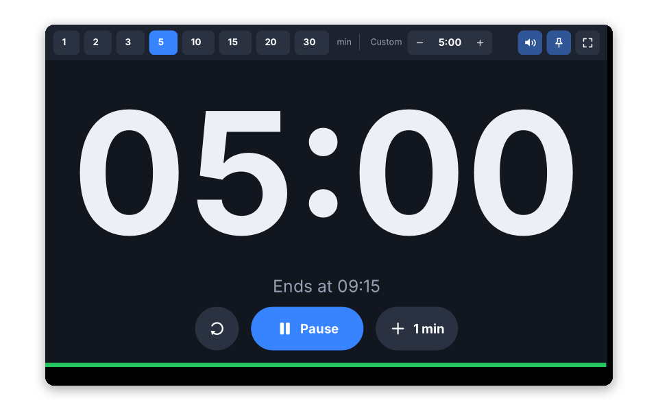 | 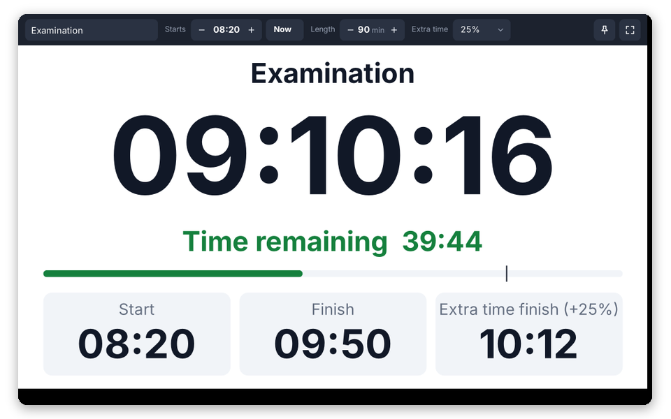 |
| 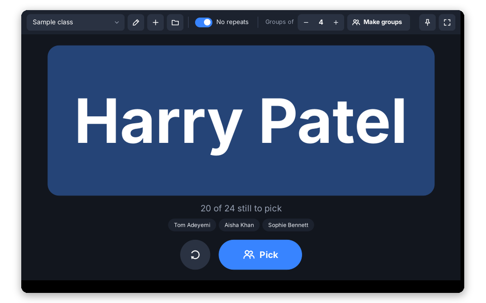 | 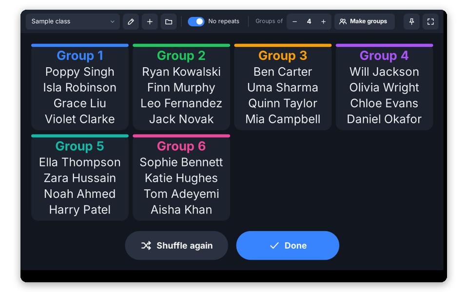 |
| 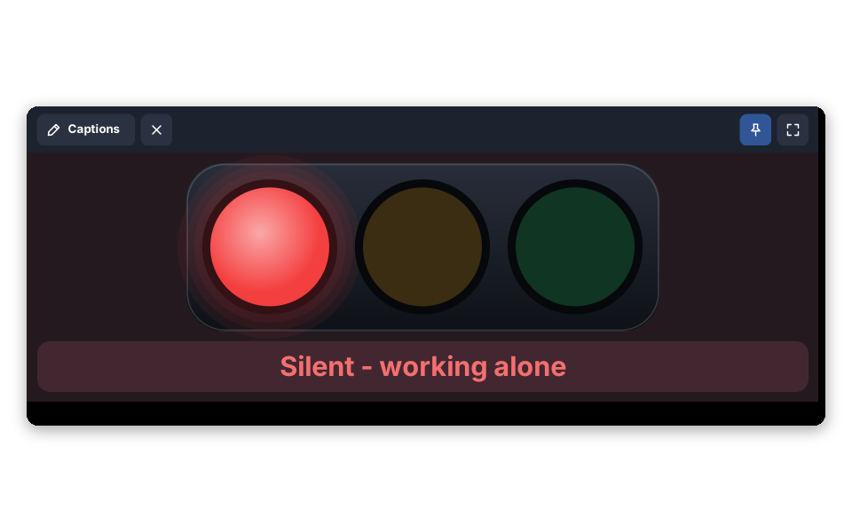 | 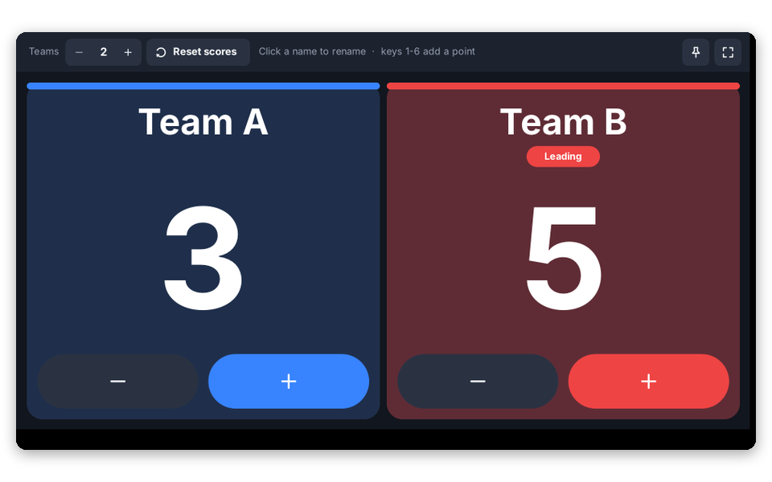 |
| 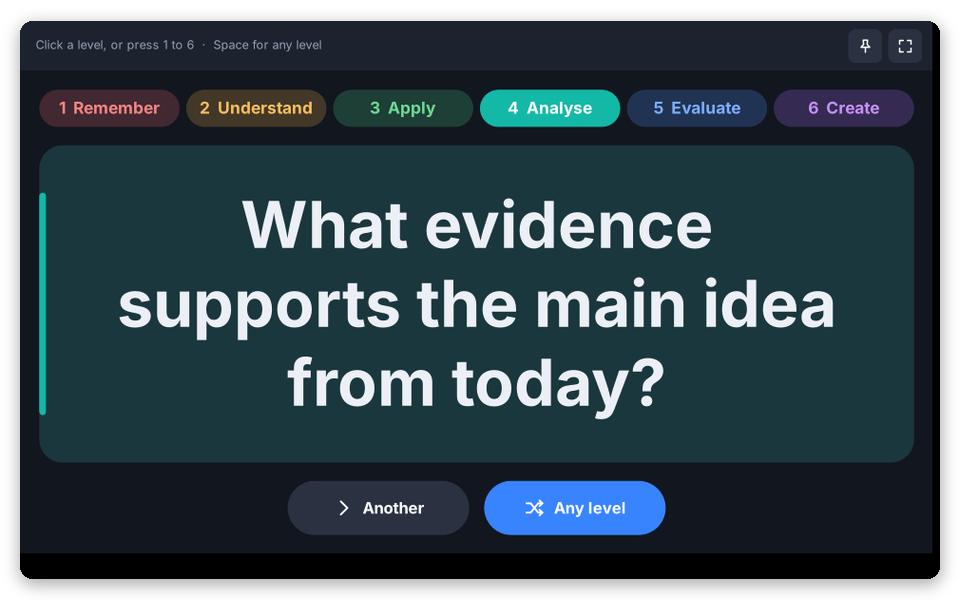 | 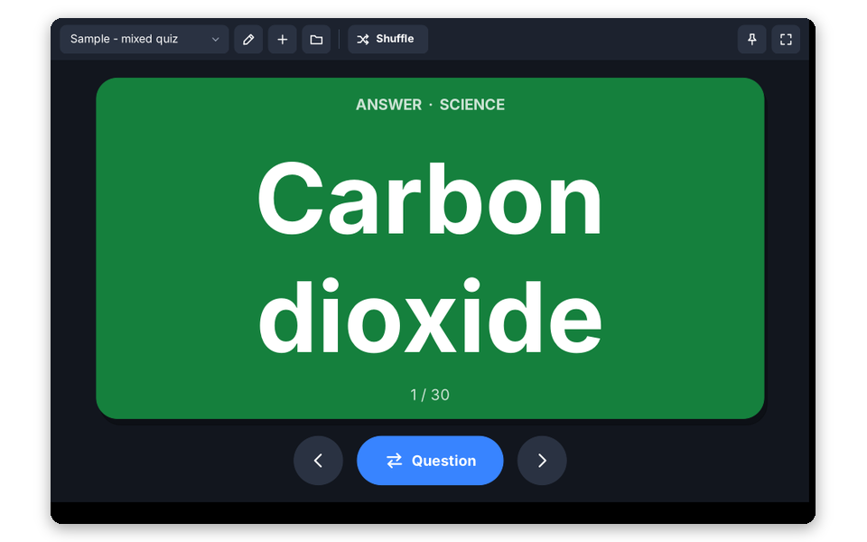 |
| 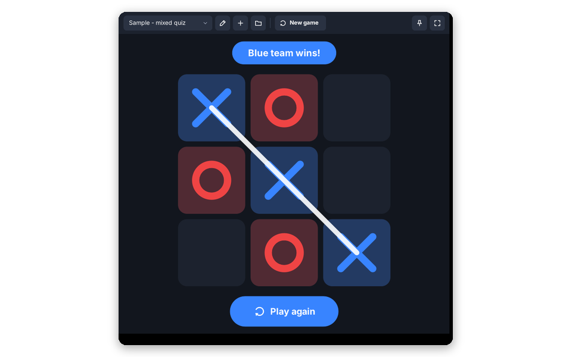 | 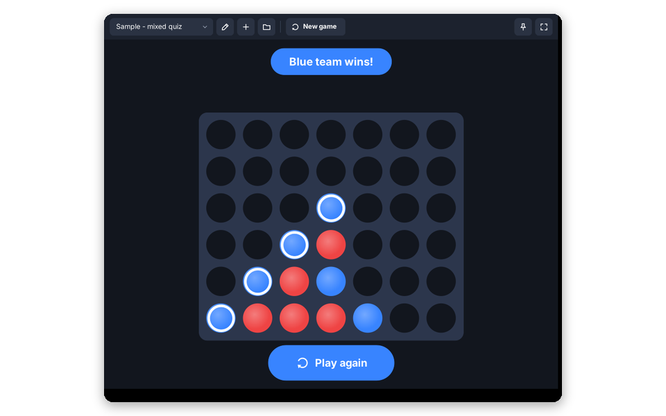 |
| 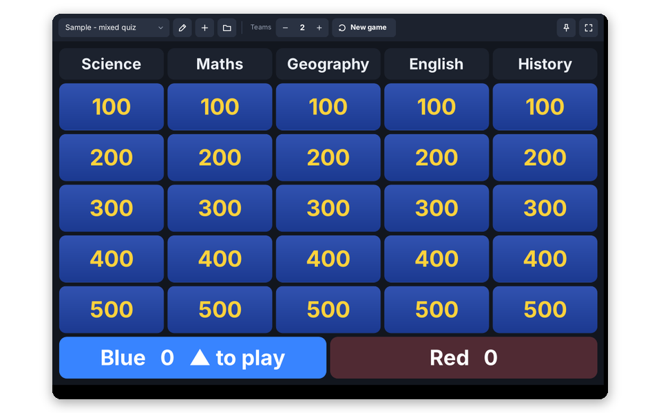 | 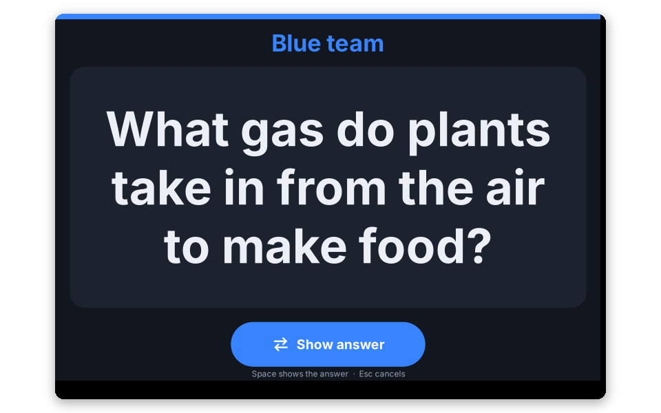 |
| 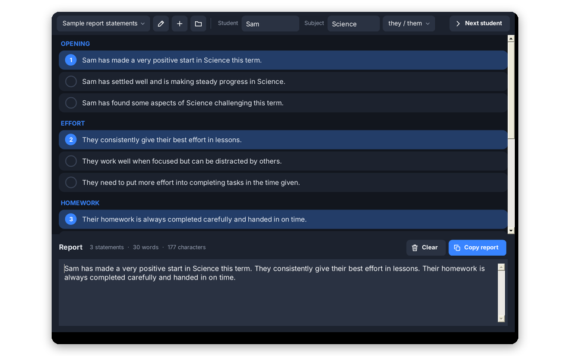 | 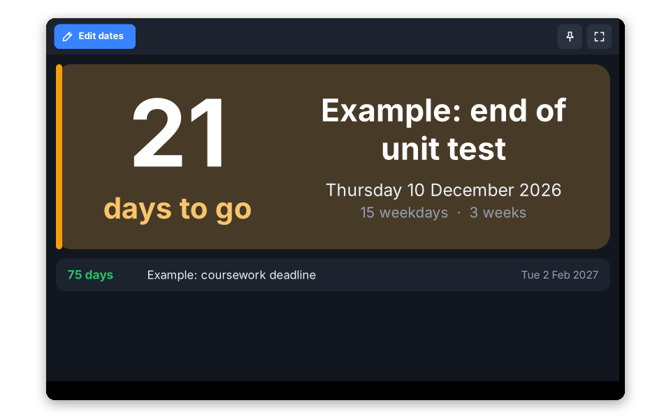 |
| 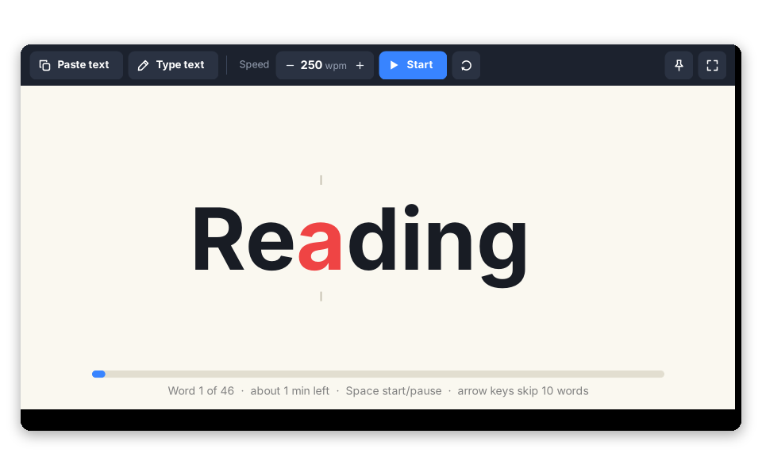 | 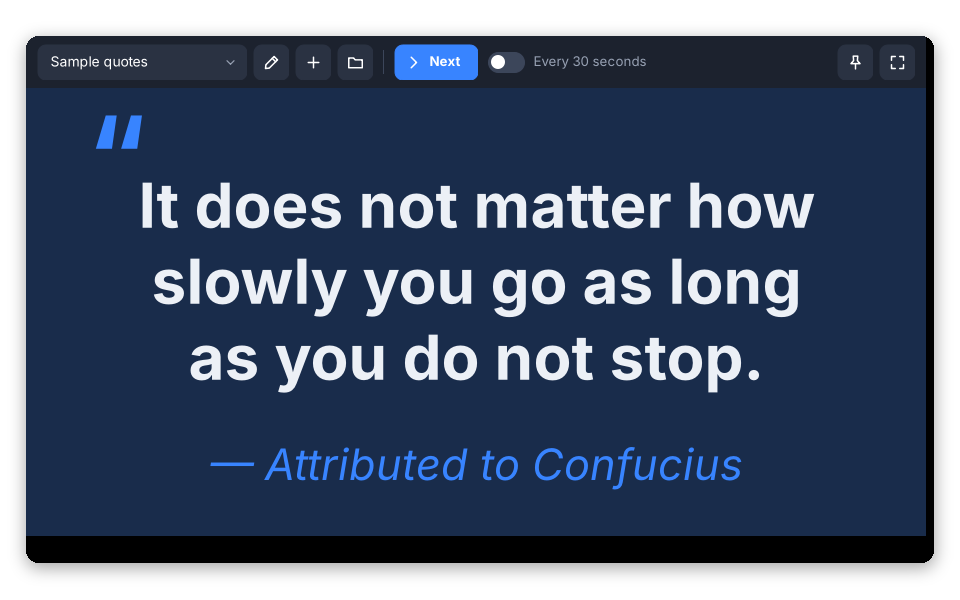 |

## Keyboard shortcuts

| Key | Where | What it does |
|---|---|---|
| **F11** | Most tools | Full screen on or off |
| **Esc** | Full screen, Draw on Screen, Cover-up | Leave full screen, or close the overlay |
| **Space** | Timers, Traffic Lights, quiz questions | Start or pause; next light; show the answer |
| **+** / **-** | Countdown Timer | Add or take off a minute |
| **L**, **R** | Stopwatch | Lap; reset |
| **N** | Interval Timer | Skip to the next period |
| **R**, **A**, **G** | Traffic Lights | Red, amber, green |
| **1** to **6** | Scoreboard | Add a point to a team (with **Shift**, take one off) |
| **Ctrl+S** | List editor | Save |
| Arrow keys, **Enter** | Launcher | Move between tools; open the highlighted tool |

## Your lists

Tools that use lists have a drop-down to choose one, and **Edit** (pencil),
**New** (plus) and **Import** (folder) buttons beside it. Lists are plain text
files in `Documents\Classroom Toolkit`, one item per line:

| Folder | Format |
|---|---|
| `Classes` | One student per line. `Sam Jones=3` gives Sam three tickets in the picker; `=0` leaves someone out. |
| `Questions` | `Question \| Answer`. A line such as `[Science]` starts a category for the Grid Quiz. `Q=` / `A=` files from older tools work too. |
| `Statements` | `#` starts a section. Placeholders: `{name}`, `{subject}`, `{he}`, `{him}`, `{his}`, `{himself}` (capitalise to start a sentence), and `{is\|are}`-style verb choices. |
| `Quotes` | One per line, optionally followed by `\| Author`. |

**Portable mode:** create an empty folder called `Data` beside
`ClassroomToolkit.exe`. If it exists and can be written to, everything is kept
there instead, which is handy on a USB stick.

## Building from source

There's nothing to install: the C# compiler is already part of Windows.

```
git clone https://github.com/LukeHarrison1990/classroom-tools.git
cd classroom-tools
build.bat            :: builds ClassroomToolkit.exe
build.bat test       :: builds and runs the tests
build.bat release    :: also makes release\ClassroomToolkit-<version>.zip
```

`ClassroomToolkit.csproj` also opens in Visual Studio 2022 and builds with
`dotnet build`. The code is C# 5 against .NET Framework 4.5, so it runs on
every supported version of Windows 10 and 11 out of the box.

## Project layout

```
src/
  Program.cs     start-up, tool list, launcher and notification-area icon
  Ui.cs          theme, drawing helpers, ToolForm base, dialogs
  Controls.cs    shared owner-drawn controls: buttons, steppers, switches, menus
  Store.cs       settings, data folders, list files and sample content
  Timers.cs      countdown, interval timer, stopwatch, exam clock
  Classroom.cs   traffic lights, pickers, dice, scoreboard, prompts, frames, ticker
  Overlays.cs    draw on screen, spotlight, reading guide, cover-up
  Games.cs       flash cards, noughts and crosses, four in a row, grid quiz
  Teacher.cs     sticky notes, reminders, exam countdown, names, reports, characters, text tidy
  Learner.cs     text to speech, speed reader, breathing, quotes and goals
tests/           logic tests (build.bat test)
assets/          app icon, logo and their sources (assets/branding)
docs/            deployment guide, screenshots and the readme shipped in the zip
site/            the website (lukeharrison1990.github.io/classroom-tools)
```

## Contributing

Bug reports, ideas from your classroom and pull requests are all welcome: see
[CONTRIBUTING.md](CONTRIBUTING.md) and the [code of conduct](CODE_OF_CONDUCT.md).
The [changelog](CHANGELOG.md) lists what's new in each version.

## Licence

Classroom Toolkit is released under the [MIT licence](LICENSE): free to use,
copy, change and share, in schools and anywhere else. It is an independent
project with no third-party code.
