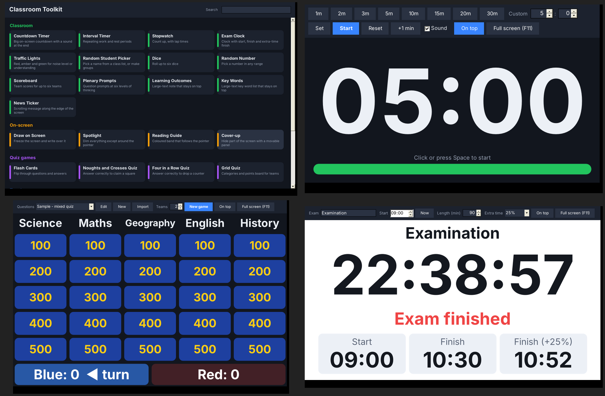

# Classroom Toolkit

A free, open-source set of classroom tools for Windows: timers, traffic lights, random student pickers, quiz games, on-screen drawing, report comments and more. It is a single small program with nothing to install and no administrator rights needed.



## Download

Get the latest `ClassroomToolkit-x.y.z.zip` from the [Releases page](../../releases/latest), extract it and run `ClassroomToolkit.exe`.

- **Works on:** Windows 10 version 1809 (including LTSC 2019) or later, and Windows 11.
- **Needs:** .NET Framework 4.5 or later, which is already part of those versions of Windows.
- **Does not need:** an installer, administrator rights, or an internet connection. It never uses the network.

It starts quietly in the notification area beside the clock. Click its icon to open the launcher. Right-click the icon for every tool, **Start with Windows**, and **Exit**.

Windows may show "Windows protected your PC" the first time, because the program is not code-signed. Choose **More info**, then **Run anyway**.

## The tools

| Group | Tools |
|---|---|
| Classroom | Countdown Timer, Interval Timer, Stopwatch, Exam Clock, Traffic Lights, Random Student Picker (with group maker), Dice, Random Number, Scoreboard, Plenary Prompts, Learning Outcomes, Key Words, News Ticker |
| On-screen | Draw on Screen, Spotlight, Reading Guide, Cover-up |
| Quiz games | Flash Cards, Noughts and Crosses Quiz, Four in a Row Quiz, Grid Quiz |
| Teacher | Sticky Notes, Register Reminders, Exam Countdown, Learn Student Names, Report Statement Builder, Special Characters, Text Tidy |
| Learner | Text to Speech, Speed Reader, Breathing Exercise, Quotes and Goals |

Most tools have **On top** and **Full screen (F11)** buttons, and keyboard shortcuts such as Space to start, pause or pick.

## Your lists

Class lists, question sets, report statement banks and quote lists are plain text files kept in `Documents\Classroom Toolkit`. Each tool that uses them has **Edit**, **New** and **Import** buttons.

| Folder | Format |
|---|---|
| `Classes` | One student per line. `Sam Jones=3` gives three tickets in the picker; `=0` leaves a student out. |
| `Questions` | One per line as `Question \| Answer`. A line such as `[Science]` starts a category for the Grid Quiz. `Q=` / `A=` line pairs also work. |
| `Statements` | `#` lines are section headings. Placeholders: `{name}` `{subject}` `{he}` `{him}` `{his}` `{himself}`, `{He}` / `{His}` to start a sentence, and `{is\|are}` style verb choices so "they" reads correctly. |
| `Quotes` | One per line, optionally followed by `\| Author`. |

**Portable use:** create an empty folder called `Data` beside `ClassroomToolkit.exe` (for example on a USB stick). If it exists and can be written to, everything is stored there instead.

## For IT staff

Deployment is a file copy. The program writes only to the user's `Documents\Classroom Toolkit` folder (or the portable `Data` folder) and to one optional per-user registry value when **Start with Windows** is ticked:
`HKCU\Software\Microsoft\Windows\CurrentVersion\Run\ClassroomToolkit`.

| Command line | Effect |
|---|---|
| `ClassroomToolkit.exe` | Starts in the notification area |
| `ClassroomToolkit.exe --show` | Also opens the launcher window |
| `ClassroomToolkit.exe --tray` | Never opens the launcher at start-up |
| `ClassroomToolkit.exe --selftest <folder>` | Opens every tool once, saves a screenshot of each and writes `selftest.txt` |

Running the program a second time brings the existing copy to the front rather than starting another.

## Building from source

The code is plain C# 5 with Windows Forms, so it builds with the compiler included in every copy of Windows. No Visual Studio or SDK is needed.

```bat
build.bat            :: builds ClassroomToolkit.exe
build.bat release    :: also makes release\ClassroomToolkit-<version>.zip
```

If you prefer, `ClassroomToolkit.csproj` builds with Visual Studio or `dotnet build` (targets .NET Framework 4.7.2).

Keep to C# 5 language features and .NET Framework 4.5 APIs so that `build.bat` keeps working on every school PC.

### Project layout

| Path | Contents |
|---|---|
| `src/Program.cs` | Start-up, tool list, launcher window, notification-area icon, self-test |
| `src/Ui.cs` | Theme, base tool window, drawing helpers, dialogs, sounds |
| `src/Store.cs` | Settings, data folders, list file formats, sample content |
| `src/Timers.cs` | Countdown, interval timer, stopwatch, exam clock |
| `src/Classroom.cs` | Traffic lights, picker, dice, number, frames, ticker, plenary prompts, scoreboard |
| `src/Overlays.cs` | Draw on screen, spotlight, reading guide, cover-up |
| `src/Games.cs` | Flash cards, noughts and crosses, four in a row, grid quiz |
| `src/Teacher.cs` | Sticky notes, reminders, exam countdown, names, statements, characters, text tidy |
| `src/Learner.cs` | Text to speech, speed reader, breathing, quotes |
| `tests/Tests.cs` | Logic checks (list formats, picker, timers, game rules, notes) |

### Releases

Pushing a version tag builds the program on GitHub and publishes a release with the zip attached:

```sh
git tag v1.0.0
git push origin v1.0.0
```

Update the version in `src/Program.cs` (`AssemblyInformationalVersion`), `CHANGELOG.md` and `docs/RELEASE_NOTES.md` first.

## Contributing

Bug reports, ideas and pull requests are welcome. Please open an issue describing the problem or idea first, with your Windows version and steps to reproduce any bug.

## Licence

[MIT](LICENSE). Copyright (c) 2026 Luke Harrison.

You may use, copy, change and share Classroom Toolkit freely, including in schools and other organisations, as long as the copyright and licence notice are kept.
